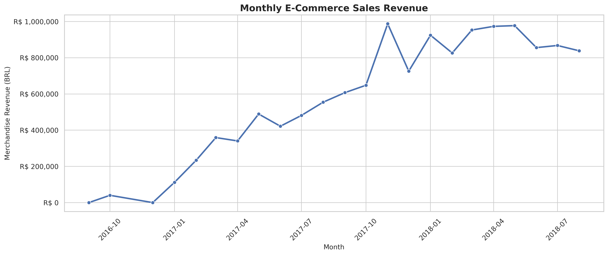
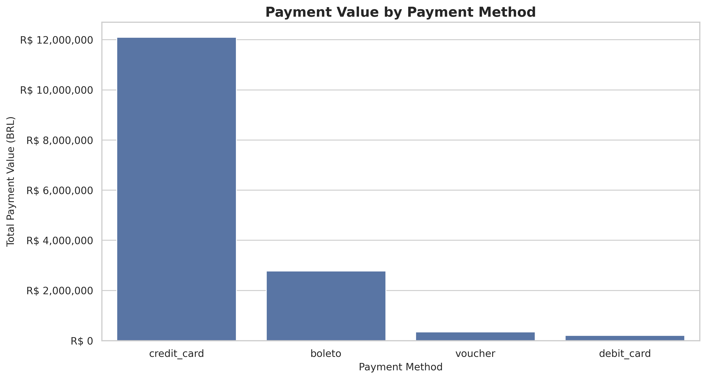
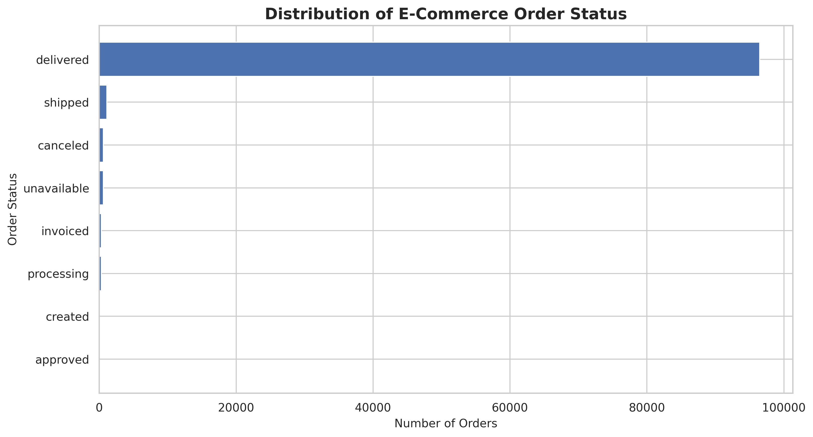
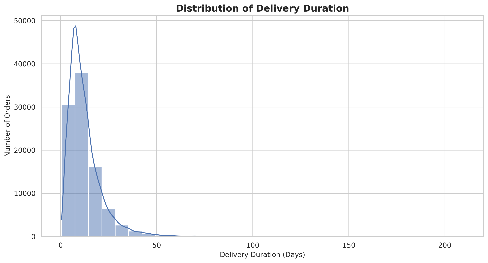
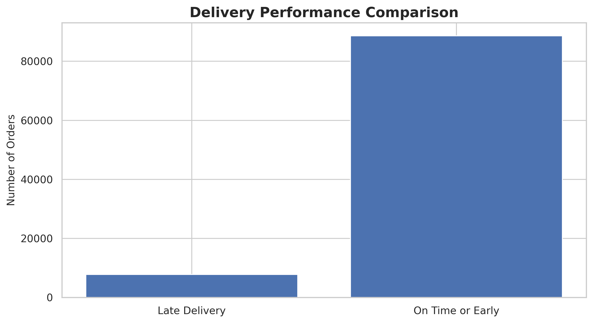

# Brazilian E-Commerce Sales Performance Analysis

## Project Overview

This project focuses on analyzing real-world Brazilian e-commerce transaction data from Olist to understand sales performance, customer payment preferences, and delivery operations.

The analysis was performed using Python in Google Colab through an Exploratory Data Analysis (EDA) approach.

## Dataset

**Source:** Brazilian E-Commerce Public Dataset by Olist

**Dataset Link:**  
https://www.kaggle.com/datasets/olistbr/brazilian-ecommerce

**License:** CC BY-NC-SA 4.0

The dataset contains approximately 100,000 orders from 2016 to 2018.

## Objectives

1. Analyze total orders and sales revenue.
2. Identify monthly sales trends.
3. Understand customer payment preferences.
4. Examine order status distribution.
5. Evaluate delivery performance.
6. Generate data-driven business insights.

## Tools & Technologies

- Python
- Google Colab
- Pandas
- NumPy
- Matplotlib
- Seaborn

## Analysis Workflow

1. Data Loading
2. Data Exploration
3. Data Quality Assessment
4. Data Cleaning and Preprocessing
5. Data Aggregation and Merging
6. Key Performance Indicator (KPI) Analysis
7. Data Visualization
8. Business Insights

## Key Performance Indicators

- Total Delivered Orders
- Total Merchandise Revenue
- Total Items Sold
- Average Order Value
- Average Freight Cost

## Data Visualizations

### 1. Monthly Sales Trend

### 2. Payment Method Analysis

### 3. Order Status Distribution

### 4. Delivery Duration

### 5. Delivery Performance

## Project Results

The project generates analytical summaries covering:

- Monthly sales performance
- Payment method distribution
- Order status distribution
- Delivery performance

The CSV summary files are available in this repository.

## How to Run

1. Download the notebook from this repository.
2. Open Google Colab.
3. Upload the three required Olist CSV files:
   - olist_orders_dataset.csv
   - olist_order_items_dataset.csv
   - olist_order_payments_dataset.csv
4. Open the notebook.
5. Run the code cells sequentially.

## Methodological Notes

- Sales KPIs are calculated using delivered orders.
- Merchandise revenue is calculated separately from freight costs.
- Payment values are analyzed independently.
- Delivery delay is measured against the estimated delivery date.
- This project uses descriptive analysis, not predictive modeling.

## Limitations

The dataset represents historical transactions from 2016–2018 and should not be interpreted as a representation of current e-commerce market conditions.

## Author

GitHub: https://github.com/samuelbisa4
